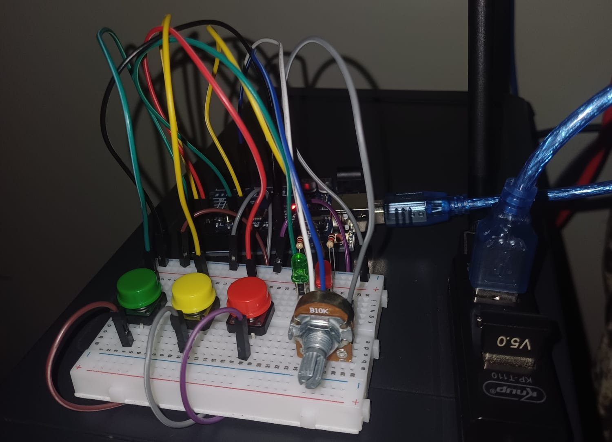
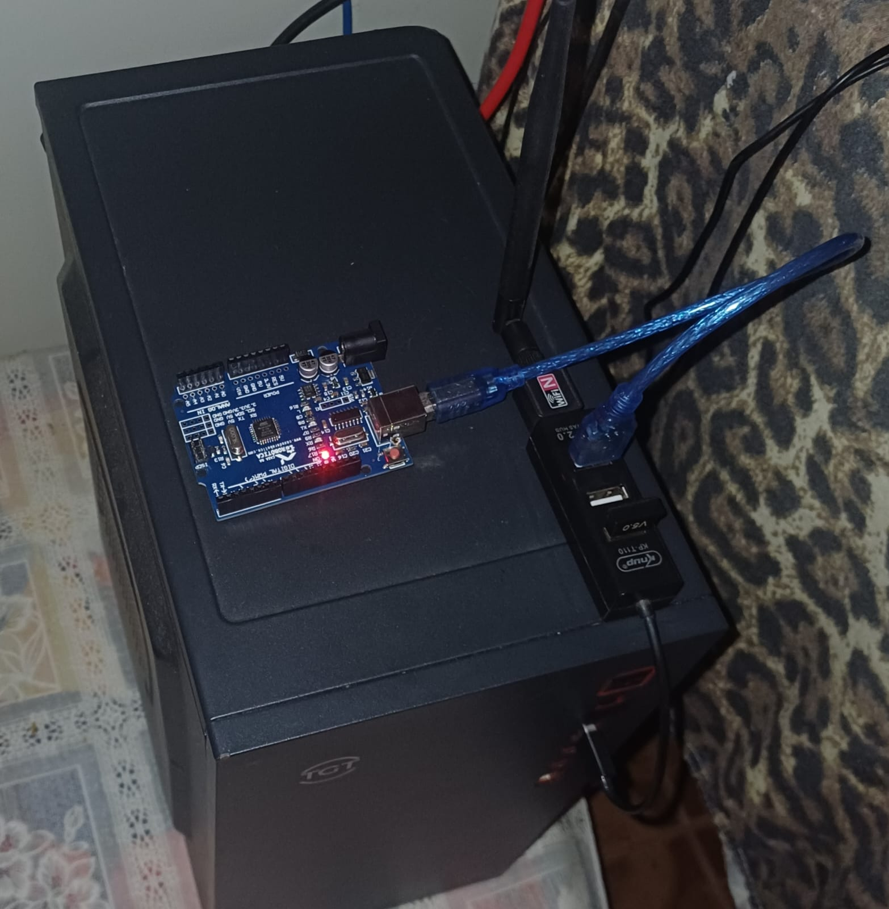
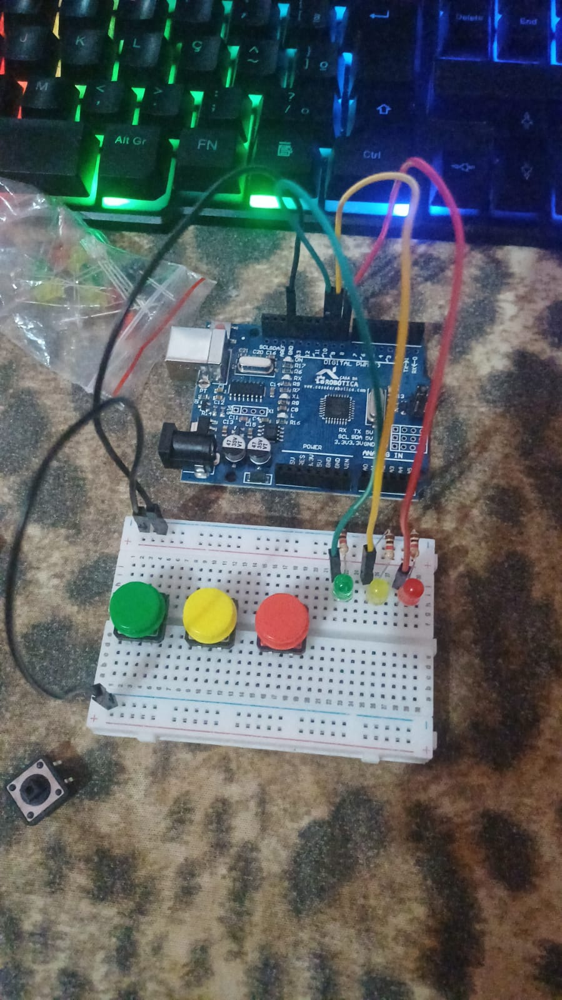
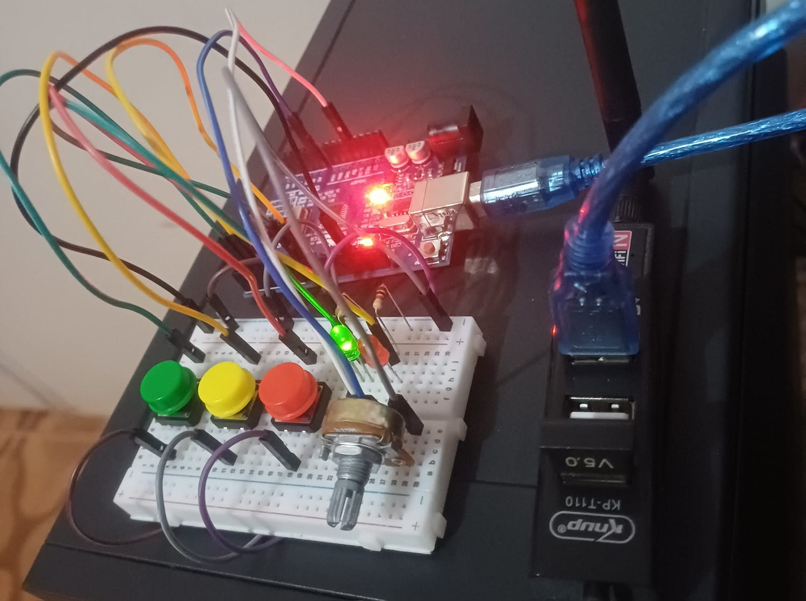

# Arduino Linux Controller


[English](README.md) | **Português (Brasil)**

Um pequeno controlador físico para Ubuntu, montado com um kit compatível com Arduino Uno que estava parado. Eu queria algo útil no dia a dia, em vez de outro laboratório inacabado. O dispositivo controla músicas, áudio e bloqueio de tela, além de indicar a conectividade do computador por dois LEDs.



*Montagem final: três botões, dois LEDs e um potenciômetro giratório B10K. A fotografia integra o [registro de montagem](images/README.pt-BR.md).*

## Índice

- [Visão geral e controles](#overview)
- [Origem e evolução](#story)
- [Tecnologias e arquivos](#stack)
- [Componentes, pinagem e montagem](#hardware)
- [Instalação, execução e autostart](#install)
- [Dificuldades e diagnóstico](#debug)
- [Validação e limitações](#validation)
- [Registro fotográfico](#photos)
- [Autoria e licença](#license)

<a id="overview"></a>

## Visão geral e controles

### Status do projeto

**Concluído — protótipo pessoal funcional, 26 de novembro de 2026.** As principais funções foram confirmadas em uso no computador físico com Ubuntu. Sem desenvolvimento ativo, roadmap ou compromisso de manutenção. Não é produto de segurança, periférico comercial ou circuito certificado.

### Controles

| Controle | Ação |
| --- | --- |
| Botão verde: toque curto / duplo / segurar 1 s | Reproduzir/pausar / faixa anterior / próxima faixa |
| Botão amarelo: toque curto | Silenciar/restaurar áudio |
| Botão vermelho: segurar 1 s | Bloquear a tela |
| Potenciômetro B10K | Ajustar volume do sistema, 0–100% |
| LED verde | NetworkManager indica internet disponível |
| LED vermelho aceso | Sem internet, conexão limitada, portal cativo ou rede desconectada |
| LED vermelho piscando | Estado desconhecido ou perda de comunicação com o computador |

### Arquitetura

```text
Botões + potenciômetro -> Arduino Uno (C++)
                             | Serial USB 9600 baud
                             v
                         Python no Ubuntu
                playerctl / wpctl / GNOME / nmcli
                             |
                       G / Y / R / U
                             v
                      LEDs verde / vermelho
```

O Arduino não se conecta à internet por conta própria. O Ubuntu verifica a conectividade e envia um caractere com o estado da rede. O Uno lê os botões com resistores internos e transmite eventos de controle e volume. O Python roda na sessão do usuário.

<a id="story"></a>

## Origem e evolução

### De um kit parado a um controlador de desktop

A ideia inicial era um laboratório de segurança embarcada: alarme de gabinete com LDR, reed switch, buzzer e registro de eventos. Esse escopo foi abandonado. A placa foi reaproveitada como periférico local do Ubuntu. Nenhum alarme, IDS, rede IoT ou monitoramento de segurança foi implementado no produto final.

A primeira proposta de controlador tinha seis botões dedicados, três LEDs de rede e buzzer/display opcionais. Os seis botões grandes cabiam na protoboard de 400 furos, mas as capas interferiam entre si. O projeto passou para três botões com toques curtos, duplos e longos, mais um potenciômetro B10K de volume. O terceiro LED foi removido posteriormente. Nenhuma peça adicional foi comprada para esta montagem.




<a id="stack"></a>

## Tecnologias e arquivos

O painel foi construído para um computador com Ubuntu e GNOME, usando uma placa Uno SMD compatível identificada como `/dev/ttyUSB0`. Não requer Docker, servidores externos ou conexão de rede própria no Arduino.

| Tecnologia | Função |
| --- | --- |
| Arduino Uno / C++ | Leitura dos botões e potenciômetro; controle dos LEDs |
| Arduino IDE | Compilação e gravação do firmware |
| USB serial / PySerial | Comunicação bidirecional a 9600 baud |
| Python 3 | Interpretação dos eventos, execução dos comandos e reconexão |
| Playerctl / MPRIS | Controle de mídia; prioridade Spotify e Firefox |
| PipeWire / WirePlumber (`wpctl`) | Volume e mute do dispositivo de áudio padrão |
| NetworkManager (`nmcli`) | Estado da conectividade do Ubuntu |
| GNOME / D-Bus / loginctl | Bloqueio da sessão gráfica |
| XDG Autostart | Execução automática após login |
| Git / GitHub | Registro do projeto concluído |

O `pactl` foi instalado apenas durante o diagnóstico; não é uma dependência do código final.

```text
arduino-linux-controller/
├── firmware/painel_ubuntu/painel_ubuntu.ino
├── software/painel-ubuntu.py
├── diagnostics/components/components.ino
├── installation/enable-autostart.sh
├── docs/
│   ├── hardware.md / hardware.pt-BR.md
│   ├── installation.md / installation.pt-BR.md
│   └── development.md / development.pt-BR.md
├── images/
│   ├── arduino-01.jpeg ... arduino-16.jpeg
│   └── README.md / README.pt-BR.md
├── README.md
├── README.pt-BR.md
├── LICENSE
└── .gitignore
```

**Códigos completos:** [firmware C++](firmware/painel_ubuntu/painel_ubuntu.ino), [programa Python](software/painel-ubuntu.py), [sketch de diagnóstico](diagnostics/components/components.ino) e [auxiliar de autostart](installation/enable-autostart.sh).

<a id="hardware"></a>

## Componentes, pinagem e montagem

> **Atenção:** o conector USB-B apresentou aquecimento anormal e interrupções durante os primeiros testes. A causa não foi comprovada. Desconecte imediatamente se o problema reaparecer; não deixe a placa suspeita energizada sem supervisão. Use uma base isolante.

### Componentes

| Quantidade | Componente | Especificação |
| --- | --- | --- |
| 1 | Placa Arduino | Compatível com Uno SMD, 5 V |
| 1 | Protoboard | 400 furos (30 grupos numerados) |
| 3 | Botões de pressão momentâneos | Normalmente abertos, capas verde/amarela/vermelha |
| 1 | LED verde | Indicador de conectividade de rede |
| 1 | LED vermelho | Indicador de conectividade de rede |
| 2 | Resistores | 1 kΩ cada, um por LED |
| 1 | Potenciômetro giratório | B10K, 10 kΩ linear |
| Conforme necessário | Jumpers | Macho-macho |
| 1 | Cabo USB | USB A–B, dados e alimentação |
| Opcional | Hub USB | Utilizado na montagem original |

Não são necessários bateria, solda, módulo sem fio, sensores ou LED amarelo para o circuito final.

### Pinagem definitiva

| Componente | Arduino | Outra conexão |
| --- | --- | --- |
| Botão verde | D2 | GND |
| Botão amarelo | D3 | GND |
| Botão vermelho | D4 | GND |
| Ânodo LED verde | D8 | Cátodo → 1 kΩ → GND |
| Ânodo LED vermelho | D9 | Cátodo → 1 kΩ → GND |
| Perna central do potenciômetro | A0 | Pernas externas → 5V e GND |
| Negativo comum | Qualquer GND | Ambos os trilhos negativos |

D10 não é utilizado. O botão amarelo permanece; o LED amarelo foi removido. O potenciômetro não requer resistor externo. Se o giro horário reduzir o volume, inverta apenas as duas pernas externas com o USB desconectado ou inverta o mapeamento no firmware.

### Montagem

1. Desconecte o USB. Apoie a placa sobre uma base rígida isolante, nunca diretamente em gabinete metálico. A placa original apresentou aquecimento intermitente sem diagnóstico conclusivo.
2. Deixe a protoboard na horizontal. Cada grupo numerado de cinco furos está conectado internamente; a divisão central isola as duas metades. Conecte GND do Arduino ao trilho negativo e una ambos os trilhos negativos; confirme continuidade se possível. Não una positivo e negativo.
3. Encaixe os três botões sobre a divisão central com espaço para as capas. Utilize dois contatos eletricamente distintos de cada botão (geralmente pernas diagonalmente opostas nos modelos de quatro pinos; confirme pelo pinout ou continuidade). Um contato vai ao pino digital e o outro ao GND comum. undefined
4. Encaixe cada LED com as pernas em grupos numerados diferentes, na mesma metade. A perna longa normalmente é o ânodo; a borda achatada identifica o cátodo. Ligue o ânodo ao D8 ou D9, o cátodo a um resistor individual de 1 kΩ e a outra ponta do resistor ao GND. O resistor em série pode ficar antes ou depois do LED.
5. Encaixe as três pernas do potenciômetro em grupos eletricamente separados. Ligue a central ao A0 e as externas ao 5V e GND. Não force o espaçamento nem permita que as pernas encostem.
6. Afaste os fios das capas e evite esmagar os jumpers roteados por baixo da protoboard. Confira curtos e metais expostos antes de energizar.

```text
D2 ── botão ── GND
D3 ── botão ── GND
D4 ── botão ── GND

D8 ── LED verde (+ para -) ── 1kΩ ── GND
D9 ── LED vermelho (+ para -) ── 1kΩ ── GND

5V ── [ potenciômetro 10kΩ ] ── GND
                 |
              cursor A0
```

O resistor de 1 kΩ foi escolhido para brilho moderado dos indicadores. Também havia resistores de 200 Ω, não selecionados para as instruções finais. Utilize a pinagem definitiva e as conexões elétricas acima como referência de montagem.

<a id="install"></a>

## Instalação, execução e autostart

Obtenha os arquivos pelo botão **Code → Download ZIP** do GitHub ou clone o repositório:

```bash
git clone https://github.com/kayo-willian/arduino-linux-controller.git
cd arduino-linux-controller
```

### 1. Preparar o Ubuntu

O ambiente funcional utilizou Ubuntu com GNOME, PipeWire/WirePlumber e NetworkManager. Instale as dependências:

```bash
sudo apt update
sudo apt install -y python3-serial playerctl wireplumber network-manager libglib2.0-bin
sudo usermod -aG dialout "$USER"
```

Saia e entre na sessão para aplicar a associação ao grupo. Não rode o programa com sudo: áudio, mídia e bloqueio dependem da sessão gráfica do usuário. Confira as ferramentas com `command -v python3 playerctl wpctl nmcli gdbus loginctl`. O utilitário opcional de diagnóstico `pactl` vem do pacote `pulseaudio-utils`; não é necessário para a execução.

### 2. Gravar o firmware

Abra [painel_ubuntu.ino](firmware/painel_ubuntu/painel_ubuntu.ino) no Arduino IDE. Selecione Arduino Uno e a porta serial correta (originalmente /dev/ttyUSB0) e grave. Encerre o Python antes de gravar e feche o monitor serial e a IDE antes de executar o Python. Somente um programa deve utilizar a porta.

Os LEDs verde e vermelho acendem sequencialmente na inicialização. Em seguida, o vermelho pisca até receber o estado da conexão do computador.

### 3. Executar o programa

Na raiz do repositório:

```bash
cp software/painel-ubuntu.py ~/painel-ubuntu.py
python3 -u ~/painel-ubuntu.py
```

Exemplo de saída esperada (a porta pode variar):

```text
Arduino conectado: /dev/ttyUSB0
READY
PLAY_PAUSE
NEXT
PREVIOUS
MUTE
VOLUME:50
LOCK
```

A saída é reproduzida exatamente como emitida pelo programa fornecido. As mensagens de estado estão em português; os identificadores de eventos seriais são independentes do idioma e não devem ser traduzidos no código.

| Mensagem/evento original | Significado |
| --- | --- |
| `Aguardando Arduino...` | Aguardando Arduino |
| `Arduino conectado:` | Arduino conectado |
| `Arduino desconectado:` | Arduino desconectado ou erro serial |
| `READY` | Firmware pronto |
| `PLAY_PAUSE` | Reproduzir/pausar |
| `NEXT` | Próxima faixa |
| `PREVIOUS` | Faixa anterior |
| `MUTE` | Silenciar/restaurar áudio |
| `VOLUME:50` | Ajustar o volume para 50% (exemplo) |
| `LOCK` | Bloquear sessão |

READY pode passar despercebido durante a conexão/reset; o programa não depende dessa mensagem. A porta é selecionada automaticamente apenas quando existe exatamente um dispositivo /dev/ttyUSB* ou /dev/ttyACM*. Desconecte outros dispositivos seriais ou adapte find_arduino. O programa tenta reconectar após falhas seriais.

O firmware permanece gravado na memória flash quando a alimentação USB é removida. Com o programa do computador em execução, ele procura uma porta serial elegível a cada três segundos enquanto estiver desconectado e tenta reabri-la após um erro serial. Reconectar o cabo USB normalmente não exige nova gravação nem abertura do Arduino IDE. Isso pressupõe uma sessão gráfica ativa, o processo do computador em execução e exatamente um dispositivo serial elegível.

### 4. Testes funcionais

| Teste | Resultado esperado |
| --- | --- |
| Abrir Spotify e tocar o verde | Reproduzir/pausar |
| Toque duplo no verde | Faixa anterior |
| Segurar verde por 1 segundo | Próxima faixa |
| Tocar amarelo | Silenciar/restaurar áudio |
| Girar potenciômetro | Ajustar volume (0–100%) |
| Segurar vermelho por 1 segundo | Bloquear sessão |
| Desconectar a rede (todas as interfaces ativas) | LED vermelho após atualização |
| Restaurar internet | LED verde |
| Encerrar Python com Ctrl+C | Vermelho piscando após 7 segundos |

As verificações do NetworkManager ocorrem aproximadamente a cada 15 segundos, mais a duração dos comandos; o computador envia o estado armazenado a cada 2 segundos. O resultado não garante acesso a todos os sites. O potenciômetro envia um novo valor após mudança de pelo menos dois pontos percentuais (ou ao atingir um extremo); não força mudança de volume ao iniciar.

### 5. Inicialização automática no login

Depois dos testes manuais, encerre o processo com Ctrl+C. Execute [enable-autostart.sh](installation/enable-autostart.sh) na raiz do repositório:

```bash
bash installation/enable-autostart.sh
```

O script copia o programa para ~/painel-ubuntu.py e cria uma entrada de inicialização automática para o usuário. O painel inicia no login gráfico, não antes da autenticação. Saia e entre na sessão para testar. Não abra outra instância se a automática já estiver em execução. Se já existir um arquivo ~/painel-ubuntu.py com conteúdo diferente, o instalador interrompe a operação para evitar sobrescrevê-lo.

### 6. Comandos de diagnóstico

Execute individualmente, apenas conforme a finalidade.

| Finalidade | Comando |
| --- | --- |
| Verificar processo | `pgrep -af painel-ubuntu.py` |
| Parar antes de gravar firmware | `pkill -f 'python3.*painel-ubuntu\.py'` |
| Identificar processo que ocupa a porta | `sudo fuser -v /dev/ttyUSB0` |
| Listar reprodutores | `playerctl --list-all` |
| Testar Spotify | `playerctl --player=spotify play-pause` |
| Consultar volume | `wpctl get-volume @DEFAULT_AUDIO_SINK@` |
| Verificar conectividade | `nmcli networking connectivity check` |
| Desativar inicialização futura | `rm ~/.config/autostart/painel-ubuntu.desktop` |

Para iniciar manualmente em segundo plano, depois de confirmar que não existe outra instância:

```bash
nohup python3 -u ~/painel-ubuntu.py > ~/.painel-ubuntu.log 2>&1 &
```

O comando de remoção da inicialização automática não encerra o processo atual. Se o conector USB aquecer anormalmente, desconecte-o imediatamente e investigue antes de continuar.

Consulte o [diário de desenvolvimento](#debug) para conhecer os problemas reais.

<a id="debug"></a>

## Dificuldades e diagnóstico

### Montagem física

| Problema ou dúvida | Observação, hipótese e resolução |
| --- | --- |
| Aquecimento do USB-B e desligamentos intermitentes | A placa já havia funcionado por horas. Foram considerados cabo defeituoso, mau contato/solda, alimentação pelo hub e curto contra mesa metálica. Mover e isolar a placa foi recomendado; o funcionamento retornou. Causa não estabelecida. |
| Espaço reduzido | O Uno não encaixa na protoboard como um Nano. A protoboard ficou na horizontal, com a placa atrás. É necessária uma base isolante. |
| Ilustrações confusas | Ilustrações preliminares apresentaram imprecisões nas posições dos furos, nos rótulos dos pinos e nas ligações do potenciômetro. Prevaleceram a pinagem definitiva e os testes físicos dos componentes. |
| Inventário de resistores | Os valores reais eram 200 Ω, 1 kΩ e 10 kΩ, e não os 330 Ω inicialmente presumidos. Escolheu-se 1 kΩ para indicadores; o resistor limita a corrente em qualquer lado do LED em série. |
| Pernas longas dos resistores | Podem ser dobradas com cuidado, sem arrancá-las ou provocar contato indevido. Não foi necessário cortar para o plano final. |
| Dificuldade de pressionar botões | As capas colidiam com seis botões; três resolveram o espaço. Jumpers longos de GND dificultavam o acesso, levando a uma mudança de rota, inclusive por baixo da protoboard. |
| Negativo comum | Ambos os trilhos negativos foram unidos; os botões utilizam INPUT_PULLUP em vez de resistores externos. Qualquer GND identificado do Arduino serve. |
| Inversão de pinos | Inicialmente o botão verde estava em D4 e o vermelho em D2; LED verde em D10 e vermelho em D8. A troca física produziu verde D2/D8 e vermelho D4/D10 inicialmente. Após retirar o indicador amarelo, o LED vermelho terminou no D9, não D10. |
| Posição do potenciômetro | Três grupos distintos de furos, perna central em A0 e externas em 5V/GND. Sem resistor extra de 10 kΩ. |





### Diagnóstico do firmware e do Ubuntu

| Sintoma | Diagnóstico e resultado |
| --- | --- |
| Erro de gravação: programmer out of sync | A compilação foi bem-sucedida (3700 bytes de flash, 291 bytes de RAM global naquela versão intermediária), mas a gravação falhou com byte esperado 0x14, recebido 0x00 e unable to write flash (rc = -1). Suspeitou-se de conflito serial ou instabilidade USB. Fechar IDE/monitor ou programa concorrente, conferir porta e reconectar foram recomendações. Não houve causa definitiva registrada para essa gravação específica. |
| Apenas o amarelo parecia responder | Mute funcionava; segurar verde avançava músicas e segurar vermelho bloqueava a tela. Isso descartou falha geral dos botões. Sugeriu-se um sketch temporário para isolar a leitura elétrica. |
| Toque curto do verde não pausava Spotify | playerctl --list-all exibiu firefox.instance_1_99 e spotify. O comando playerctl --player=spotify play-pause funcionou. O programa passou a priorizar spotify,firefox nas três operações de mídia; o toque curto funcionou depois. |
| Potenciômetro não controlava volume | O jumper A0 estava desconectado e foi recolocado. Comandos wpctl retornaram sem erros; pactl inicialmente não existia, então pulseaudio-utils foi instalado para diagnóstico. Ausência de saída em comandos bem-sucedidos é normal. Sugeriu-se analogRead(A0) direto; o painel completo foi posteriormente confirmado funcional, mas não foram fornecidos logs brutos do ADC nem causa secundária definitiva. |
| Três indicadores desnecessários | LED amarelo retirado; firmware passou a agrupar internet limitada/ausente e rede desconectada em um LED vermelho. O botão amarelo permaneceu. |
| Indicador offline não acendia | Enviar R pelo monitor serial não acendia o LED. O código ainda usava D10, mas o indicador estava fisicamente em D9. Corrigiu-se o pino e trocou-se o LED amarelo temporário por um vermelho. |
| Device or resource busy | O Python falhou repetidamente com Errno 16 em /dev/ttyUSB0 e depois exibiu READY; naquele momento nenhum botão respondia. Perda do GND comum foi considerada, mas posteriormente observou-se disputa entre Arduino IDE e Python. Fechar a IDE e evitar processos Python duplicados resolveu o conflito relatado. |
| Inicialização automática removida por engano | O comando opcional de remoção foi executado junto dos demais. A entrada desktop foi recriada e o processo conferido. |
| Processos duplicados após reinicialização manual | Foram observados dois processos Python (PIDs 25218 e 25280). Ambos indicavam 0,3% de CPU e aproximadamente 13,4–13,5 MiB de memória residente. Os dois foram encerrados e um processo foi iniciado; pgrep mostrou então somente o PID 31492. São medições históricas, não PIDs atuais nem garantia de consumo de recursos. |

Trechos dos erros:

```text
Error: protocol expects sync byte 0x14 but got 0x00
Error: programmer is out of sync
Error: unable to write flash (rc = -1)
Failed uploading: uploading error: exit status 1
Arduino desconectado: [Errno 16] could not open port /dev/ttyUSB0:
[Errno 16] Device or resource busy: '/dev/ttyUSB0'
Arduino conectado: /dev/ttyUSB0
READY
```

A saída original dos erros foi preservada para facilitar o diagnóstico. As mensagens abaixo explicam seu significado.

| Mensagem original | Significado |
| --- | --- |
| `protocol expects sync byte 0x14 but got 0x00` | Byte de sincronização esperado difere do recebido |
| `programmer is out of sync` | A comunicação com o gravador não está sincronizada |
| `unable to write flash (rc = -1)` | Falha na gravação da memória flash |
| `Failed uploading: uploading error: exit status 1` | Falha no envio do firmware |
| `Device or resource busy` | Dispositivo ou recurso ocupado |
| `Arduino desconectado` / `Arduino conectado` | Arduino desconectado / conectado |
| `READY` | Firmware pronto |

Testes isolados úteis: encerre o Python primeiro, envie G/R/U pelo monitor serial em 9600 baud (timeout dos LEDs de 7 s); teste os botões e A0 com o [sketch de diagnóstico](diagnostics/components/components.ino); grave novamente o firmware principal ao terminar. O diagnóstico incluído combina os testes anteriormente sugeridos para a pinagem final, não é um sketch validado separadamente.

<a id="validation"></a>

## Validação e limitações

### Aceitação final

Após resolver pinagem e conflito serial, o responsável pela montagem confirmou todas as funções: reproduzir/pausar, anterior/próxima, mute, volume, bloqueio de tela e indicadores online/offline. A inicialização automática foi configurada e o processo foi observado rodando. Não houve validação independente de reinicializações repetidas, estabilidade elétrica de longo prazo, tempos exatos ou outras distribuições.

### Notas técnicas e limitações

- Serial: 9600 baud, linhas ASCII do firmware (READY, PLAY_PAUSE, PREVIOUS, NEXT, MUTE, LOCK, VOLUME:n); caracteres G/Y/R/U do computador. Y e R significam vermelho aceso; U significa piscando. Sem autenticação ou emulação USB HID.
- Firmware: entradas ativas em nível baixo, debounce de 35 ms, intervalo de toque duplo de 350 ms, toque longo de 1 s; média de oito amostras ADC a cada 100 ms, limiar de 2% de volume e timeout de 7 s.
- Computador: pressupõe um único dispositivo serial, subprocess sem shell, requer sessão gráfica; mídia limitada a reprodutores MPRIS compatíveis, com prioridade Spotify/Firefox. O Arduino não recebe dados da rede diretamente.
- Conectividade é a avaliação do NetworkManager, não garantia independente de acesso à internet. A execução dos comandos pode atrasar o processamento serial; reconexão em melhor esforço.
- Não foram executados testes automatizados formais ou de longa duração no protótipo. O código foi reconstruído da conversa, preservando lógica funcional e pinagem final. O auxiliar de autostart e o diagnóstico combinado são adições documentais, sem alegação de teste físico.
- O aquecimento original permanece sem diagnóstico conclusivo; isole a placa e desconecte diante de calor anormal ou instabilidade.

O projeto termina aqui: um periférico pessoal funcional, não uma plataforma em manutenção.

<a id="photos"></a>

## Registro fotográfico

As 16 fotografias reais foram preservadas na pasta [images/](images/). As primeiras imagens registram a montagem em andamento; o conjunto final contém diferentes ângulos e uma foto da placa isolada. Imagens antigas não representam a pinagem definitiva.

| Conjunto | Fotografias |
| --- | --- |
| Primeiros testes e montagem | [01](images/arduino-01.jpeg) · [02](images/arduino-02.jpeg) · [03](images/arduino-03.jpeg) · [04](images/arduino-04.jpeg) · [05](images/arduino-05.jpeg) · [06](images/arduino-06.jpeg) |
| Sessão final | [07](images/arduino-07.jpeg) · [08](images/arduino-08.jpeg) · [09](images/arduino-09.jpeg) · [10](images/arduino-10.jpeg) · [11](images/arduino-11.jpeg) · [12](images/arduino-12.jpeg) · [13](images/arduino-13.jpeg) · [14](images/arduino-14.jpeg) · [15](images/arduino-15.jpeg) · [16](images/arduino-16.jpeg) |

| Vista frontal | Outra vista do dispositivo |
| --- | --- |
|  |  |

Consulte também o [índice de fotos](images/README.pt-BR.md).

<a id="license"></a>

## Autoria e licença

### Autoria

Eu realizei a montagem, alterei as ligações, gravei o firmware e testei o dispositivo físico. O código publicado reconstrói a versão funcional com base nos registros de desenvolvimento; não é uma cópia byte a byte dos arquivos locais.

As versões separadas da documentação continuam disponíveis para consulta: [hardware](docs/hardware.pt-BR.md), [instalação](docs/installation.pt-BR.md) e [diário de desenvolvimento](docs/development.pt-BR.md). Todo o conteúdo necessário para reproduzir o projeto está neste README.

Licenciado sob a [MIT](LICENSE).

### Créditos

O ChatGPT (IA) auxiliou na elaboração dos códigos em C++ e Python, na resolução de problemas e na documentação técnica.
