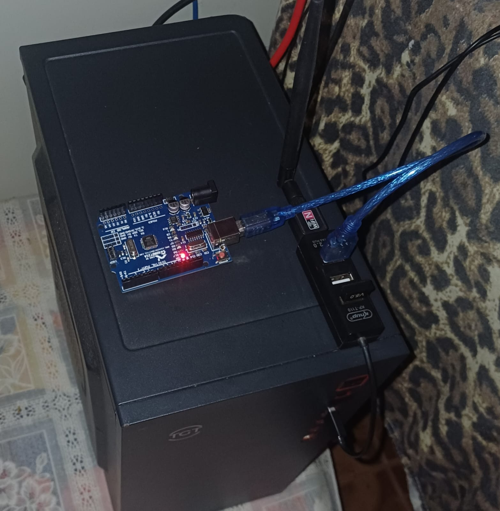
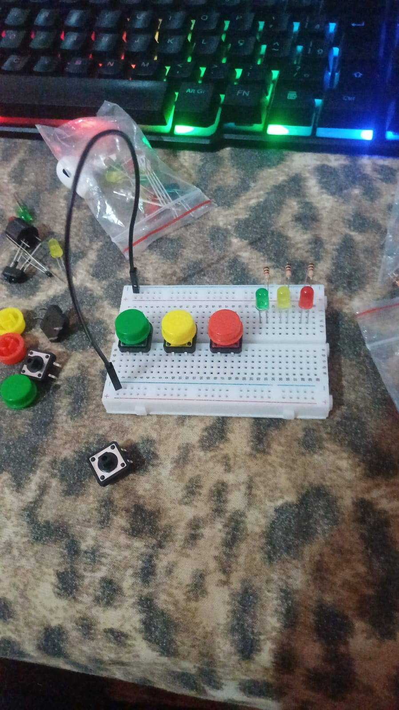
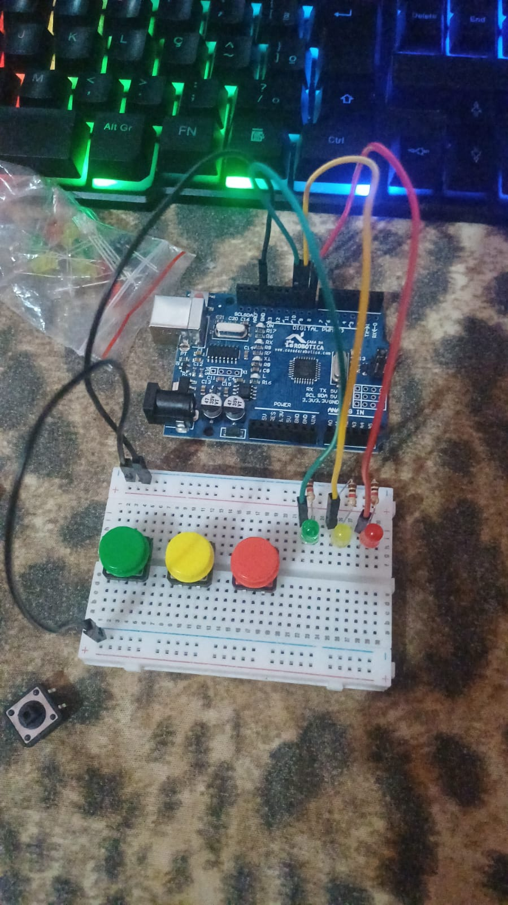

# Development log and troubleshooting

[Português (Brasil)](development.pt-BR.md) · [Home](../README.md)

**26 November 2026 — one physical prototype, completed.** This is a retrospective of the actual development conversation, not a laboratory certification. Confirmed observations are distinguished from suggestions and unresolved hypotheses.

## From an unused kit to a desktop controller

The original idea was an embedded security lab: an enclosure alarm using an LDR, reed switch, buzzer and event logging. That scope was abandoned. The board was instead reused for a local Ubuntu peripheral. No alarm, intrusion detection, IoT network or security monitoring was implemented in the final device.

The first desktop-controller proposal had six dedicated buttons, three network LEDs, and optional buzzer/display. Six large switches physically fit across a 400-hole breadboard, but their colored caps interfered. The design was reduced to three buttons with short, double and long presses, plus a B10K potentiometer for volume. The third LED was later removed. No additional components were purchased for this build.




## Physical assembly

| Problem or question | Observation, hypothesis and resolution |
| --- | --- |
| USB-B connector warming and intermittent shutdown | The board previously worked for hours. Cable damage, bad connector/solder, hub power and a short against a metal table were considered. Moving the board and isolating it was advised; operation resumed. Cause not established. |
| Small workspace | The Uno cannot plug into the breadboard like a Nano. The breadboard was placed horizontally, with the board behind it. An insulating support is required. |
| Illustrations misleading | AI-generated images depicted inaccurate holes, pin labels and potentiometer wiring. They were rejected as wiring authority; the electrical pinout and actual component tests took precedence. |
| Resistor inventory | Actual values were 200 Ω, 1 kΩ and 10 kΩ, not the initially assumed 330 Ω. 1 kΩ was selected for indicators; current limiting works on either side of an LED in series. |
| Long resistor leads | Leads can be bent carefully, without pulling them out or allowing shorts. No cutting was required for the final plan. |
| Buttons difficult to press | Caps collided with six switches; three switches solved spacing. Long ground jumpers obstructed access; the final physical routing was changed, including passing wires beneath the breadboard. |
| Common ground | Both negative rails were connected; buttons use INPUT_PULLUP rather than external resistors. Any labeled Arduino GND is suitable. |
| Pin reversals | The first layout had green button D4, red D2; green LED D10, red D8. The components were swapped, yielding green D2/D8 and red D4/D10 initially. After removing the yellow indicator, the red LED ultimately occupied D9, not D10. |
| Potentiometer placement | Three distinct breadboard groups were required, with the middle contact to A0 and outer contacts to 5V/GND. No extra 10 kΩ resistor. |






## Firmware and host debugging

| Symptom | Diagnosis and outcome |
| --- | --- |
| Upload error: programmer out of sync | Compiler succeeded (3700 bytes flash, 291 bytes global RAM for that intermediate sketch), but upload failed with sync byte 0x14 vs 0x00 and unable to write flash (rc = -1). Serial contention or USB instability were suspected. Closing the IDE/monitor or competing program, checking the port and reconnecting were recommended. No definitive cause was recorded for this particular upload error. |
| Only yellow seemed responsive | Mute worked; green long press advanced tracks and red long press locked the desktop. This ruled out a general failure of all buttons. A temporary component sketch was suggested to isolate electrical input. |
| Green short press did not pause Spotify | playerctl --list-all showed firefox.instance_1_99 and spotify. The explicit command playerctl --player=spotify play-pause worked. The host was changed to prioritize spotify,firefox for all three media operations; the short press then worked. |
| Potentiometer failed to control volume | A0 jumper was found disconnected and reattached. Direct wpctl commands returned without errors; pactl was initially missing, so pulseaudio-utils was installed for diagnostics. No output on successful volume commands is normal. Reading analogRead(A0) directly was suggested; the final complete panel was subsequently reported working, but no raw ADC log or definitive secondary cause was supplied. |
| Three indicators unnecessary | Yellow LED removed; the firmware combined limited/no internet and disconnected states into one red indicator. The yellow physical button remained. |
| Offline LED would not light | Sending R through the serial monitor did not light it. The code still targeted D10, but the indicator was physically connected to D9. Correcting the pin and replacing the temporary yellow LED with red resolved the mismatch. |
| Device or resource busy | Python repeatedly failed with Errno 16 on /dev/ttyUSB0 and later printed READY; no buttons responded at that point. A common-ground issue was considered, but contention between Arduino IDE and the host was subsequently observed. Closing the IDE and avoiding duplicate Python processes resolved the reported conflict. |
| Autostart removed accidentally | The optional removal command was executed along with the others. The desktop entry was recreated and the process checked. |

Relevant error excerpts:

```text
Error: protocol expects sync byte 0x14 but got 0x00
Error: programmer is out of sync
Error: unable to write flash (rc = -1)
Failed uploading: uploading error: exit status 1
Arduino desconectado: [Errno 16] could not open port /dev/ttyUSB0:
[Errno 16] Device or resource busy: '/dev/ttyUSB0'
Arduino conectado: /dev/ttyUSB0
READY
```

Useful isolated tests: stop Python first, send G/R/U using the serial monitor at 9600 baud (LED timeout 7 s); test the switch readings and A0 with the [component diagnostic sketch](../diagnostics/components/components.ino); re-upload the main firmware afterwards. The included diagnostic combines earlier suggested tests for the final pinout, rather than reproducing a separately validated sketch.

## Final acceptance

The builder reported all functions working after resolving the pin and serial conflicts: play/pause, previous/next, mute, volume, screen lock, online/offline LEDs. Autostart was configured and the process was observed running. Repeated reboot testing, long-term electrical stability, exact timings and behavior on other distributions were not independently validated.


## Technical notes and limitations

- Serial: 9600 baud, ASCII lines from firmware (READY, PLAY_PAUSE, PREVIOUS, NEXT, MUTE, LOCK, VOLUME:n); G/Y/R/U characters from host. Y and R both mean red steady; U means blinking. No authentication or USB HID emulation.
- Firmware: active-low inputs, 35 ms debounce, 350 ms double-click interval, 1 s long press; eight ADC samples averaged every 100 ms, 2% volume threshold; host timeout 7 s.
- Host: one serial device assumed, commands via subprocess without a shell, desktop-session access required; media limited to supported MPRIS players with Spotify/Firefox priority. No network data is received directly by the Arduino.
- Connectivity is NetworkManager's assessment, not an independent internet availability guarantee. Command execution can delay serial processing; reconnection is best effort.
- No formal automated tests or endurance tests were performed on the physical prototype. The source is reconstructed from the conversation, preserving the working logic and final pinout. The autostart helper and combined diagnostic are documentation additions, not claimed hardware-tested.
- The original heating incident remains unresolved; isolate the PCB and unplug on abnormal heat or instability.

The project ends here: a functional personal peripheral, not a maintained platform.
