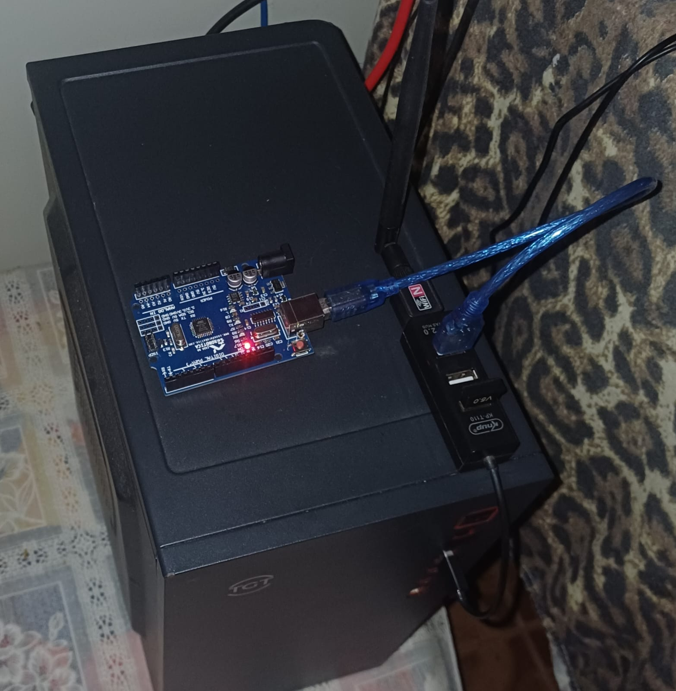
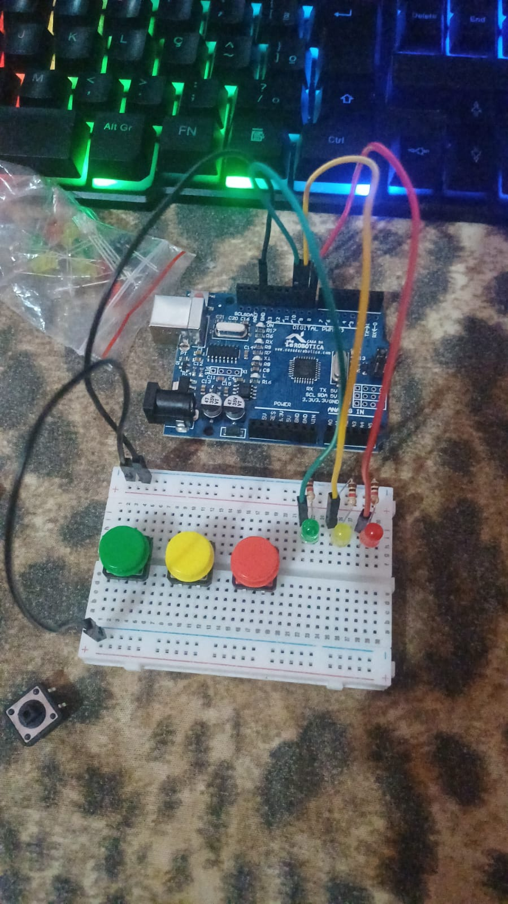

# Diário de desenvolvimento e diagnóstico

[English](development.md) · [Início](../README.pt-BR.md)

**26 de novembro de 2026 — um protótipo físico concluído.** Registro retrospectivo da conversa de desenvolvimento, não uma certificação laboratorial. Observações confirmadas, sugestões e hipóteses não conclusivas são separadas.

## De um kit parado a um controlador de desktop

A ideia inicial era um laboratório de segurança embarcada: alarme de gabinete com LDR, reed switch, buzzer e registro de eventos. Esse escopo foi abandonado. A placa foi reaproveitada como periférico local do Ubuntu. Nenhum alarme, IDS, rede IoT ou monitoramento de segurança foi implementado no produto final.

A primeira proposta de controlador tinha seis botões dedicados, três LEDs de rede e buzzer/display opcionais. Os seis botões grandes cabiam na protoboard de 400 furos, mas as capas interferiam entre si. O projeto passou para três botões com toques curtos, duplos e longos, mais um potenciômetro B10K de volume. O terceiro LED foi removido posteriormente. Nenhuma peça adicional foi comprada para esta montagem.




## Montagem física

| Problema ou dúvida | Observação, hipótese e resolução |
| --- | --- |
| Aquecimento do USB-B e desligamentos intermitentes | A placa já havia funcionado por horas. Foram considerados cabo defeituoso, mau contato/solda, alimentação pelo hub e curto contra mesa metálica. Mover e isolar a placa foi recomendado; o funcionamento retornou. Causa não estabelecida. |
| Espaço reduzido | O Uno não encaixa na protoboard como um Nano. A protoboard ficou na horizontal, com a placa atrás. É necessária uma base isolante. |
| Ilustrações confusas | Imagens geradas por IA mostraram furos, rótulos de pinos e ligações do potenciômetro incorretos. Foram descartadas como referência elétrica; prevaleceram pinagem e testes reais. |
| Inventário de resistores | Os valores reais eram 200 Ω, 1 kΩ e 10 kΩ, e não os 330 Ω inicialmente presumidos. Escolheu-se 1 kΩ para indicadores; o resistor limita a corrente em qualquer lado do LED em série. |
| Pernas longas dos resistores | Podem ser dobradas com cuidado, sem arrancá-las ou provocar contato indevido. Não foi necessário cortar para o plano final. |
| Dificuldade de pressionar botões | As capas colidiam com seis botões; três resolveram o espaço. Jumpers longos de GND dificultavam o acesso, levando a uma mudança de rota, inclusive por baixo da protoboard. |
| Negativo comum | Ambos os trilhos negativos foram unidos; os botões utilizam INPUT_PULLUP em vez de resistores externos. Qualquer GND identificado do Arduino serve. |
| Inversão de pinos | Inicialmente o botão verde estava em D4 e o vermelho em D2; LED verde em D10 e vermelho em D8. A troca física produziu verde D2/D8 e vermelho D4/D10 inicialmente. Após retirar o indicador amarelo, o LED vermelho terminou no D9, não D10. |
| Posição do potenciômetro | Três grupos distintos de furos, perna central em A0 e externas em 5V/GND. Sem resistor extra de 10 kΩ. |





## Diagnóstico do firmware e do Ubuntu

| Sintoma | Diagnóstico e resultado |
| --- | --- |
| Erro de gravação: programmer out of sync | A compilação foi bem-sucedida (3700 bytes de flash, 291 bytes de RAM global naquela versão intermediária), mas a gravação falhou com byte esperado 0x14, recebido 0x00 e unable to write flash (rc = -1). Suspeitou-se de conflito serial ou instabilidade USB. Fechar IDE/monitor ou programa concorrente, conferir porta e reconectar foram recomendações. Não houve causa definitiva registrada para essa gravação específica. |
| Apenas o amarelo parecia responder | Mute funcionava; segurar verde avançava músicas e segurar vermelho bloqueava a tela. Isso descartou falha geral dos botões. Sugeriu-se um sketch temporário para isolar a leitura elétrica. |
| Toque curto do verde não pausava Spotify | playerctl --list-all exibiu firefox.instance_1_99 e spotify. O comando playerctl --player=spotify play-pause funcionou. O programa passou a priorizar spotify,firefox nas três operações de mídia; o toque curto funcionou depois. |
| Potenciômetro não controlava volume | O jumper A0 estava desconectado e foi recolocado. Comandos wpctl retornaram sem erros; pactl inicialmente não existia, então pulseaudio-utils foi instalado para diagnóstico. Ausência de saída em comandos bem-sucedidos é normal. Sugeriu-se analogRead(A0) direto; o painel completo foi posteriormente confirmado funcional, mas não foram fornecidos logs brutos do ADC nem causa secundária definitiva. |
| Três indicadores desnecessários | LED amarelo retirado; firmware passou a agrupar internet limitada/ausente e rede desconectada em um LED vermelho. O botão amarelo permaneceu. |
| Indicador offline não acendia | Enviar R pelo monitor serial não acendia o LED. O código ainda usava D10, mas o indicador estava fisicamente em D9. Corrigiu-se o pino e trocou-se o LED amarelo temporário por um vermelho. |
| Device or resource busy | O Python falhou repetidamente com Errno 16 em /dev/ttyUSB0 e depois exibiu READY; naquele momento nenhum botão respondia. Perda do GND comum foi considerada, mas posteriormente observou-se disputa entre Arduino IDE e Python. Fechar a IDE e evitar processos Python duplicados resolveu o conflito relatado. |
| Inicialização automática removida por engano | O comando opcional de remoção foi executado junto dos demais. A entrada desktop foi recriada e o processo conferido. |

Trechos dos erros:

```text
Error: protocol expects sync byte 0x14 but got 0x00
Error: programmer is out of sync
Error: unable to write flash (rc = -1)
Failed uploading: uploading error: exit status 1
Arduino desconectado: [Errno 16] could not open port /dev/ttyUSB0:
[Errno 16] Device or resource busy: '/dev/ttyUSB0'
Arduino conectado: /dev/ttyUSB0
READY
```

Testes isolados úteis: encerre o Python primeiro, envie G/R/U pelo monitor serial em 9600 baud (timeout dos LEDs de 7 s); teste os botões e A0 com o [sketch de diagnóstico](../diagnostics/components/components.ino); grave novamente o firmware principal ao terminar. O diagnóstico incluído combina os testes anteriormente sugeridos para a pinagem final, não é um sketch validado separadamente.

## Aceitação final

Após resolver pinagem e conflito serial, o responsável pela montagem confirmou todas as funções: reproduzir/pausar, anterior/próxima, mute, volume, bloqueio de tela e indicadores online/offline. A inicialização automática foi configurada e o processo foi observado rodando. Não houve validação independente de reinicializações repetidas, estabilidade elétrica de longo prazo, tempos exatos ou outras distribuições.


## Notas técnicas e limitações

- Serial: 9600 baud, linhas ASCII do firmware (READY, PLAY_PAUSE, PREVIOUS, NEXT, MUTE, LOCK, VOLUME:n); caracteres G/Y/R/U do computador. Y e R significam vermelho aceso; U significa piscando. Sem autenticação ou emulação USB HID.
- Firmware: entradas ativas em nível baixo, debounce de 35 ms, intervalo de toque duplo de 350 ms, toque longo de 1 s; média de oito amostras ADC a cada 100 ms, limiar de 2% de volume e timeout de 7 s.
- Computador: pressupõe um único dispositivo serial, subprocess sem shell, requer sessão gráfica; mídia limitada a reprodutores MPRIS compatíveis, com prioridade Spotify/Firefox. O Arduino não recebe dados da rede diretamente.
- Conectividade é a avaliação do NetworkManager, não garantia independente de acesso à internet. A execução dos comandos pode atrasar o processamento serial; reconexão em melhor esforço.
- Não foram executados testes automatizados formais ou de longa duração no protótipo. O código foi reconstruído da conversa, preservando lógica funcional e pinagem final. O auxiliar de autostart e o diagnóstico combinado são adições documentais, sem alegação de teste físico.
- O aquecimento original permanece sem diagnóstico conclusivo; isole a placa e desconecte diante de calor anormal ou instabilidade.

O projeto termina aqui: um periférico pessoal funcional, não uma plataforma em manutenção.
