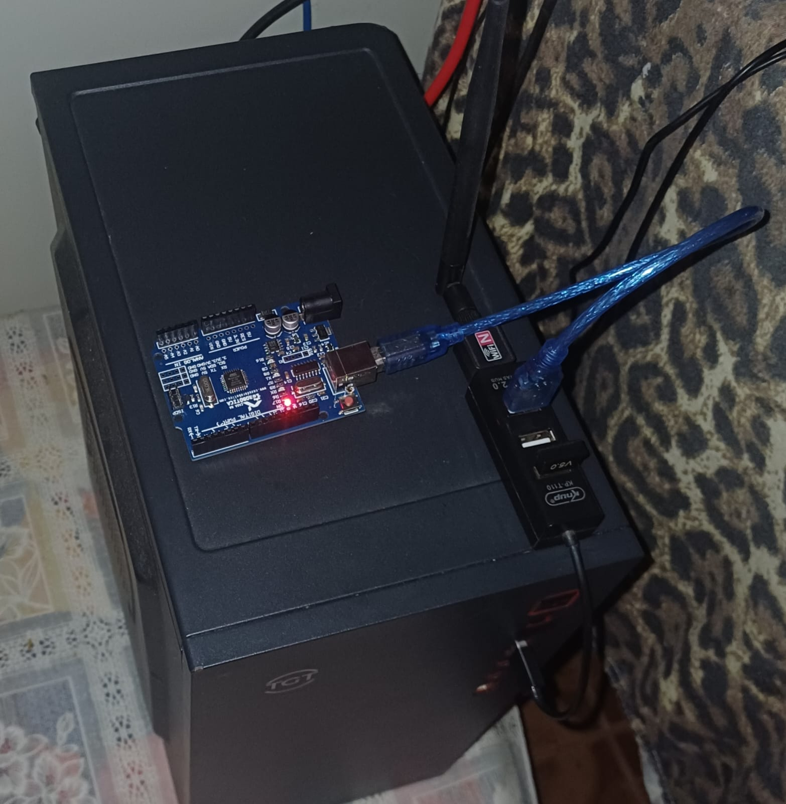
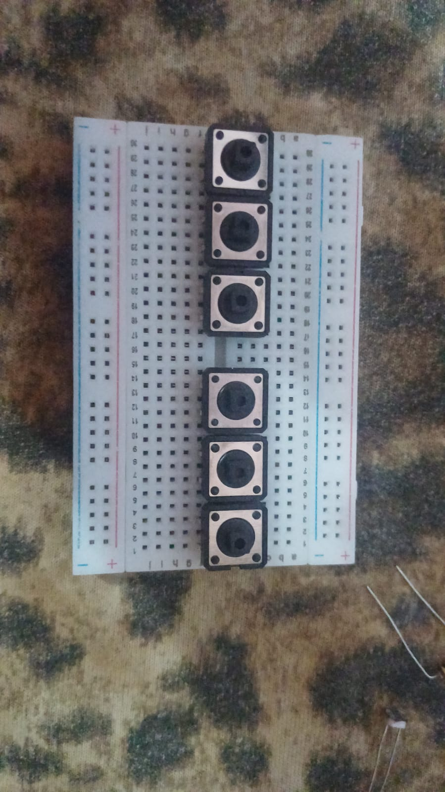
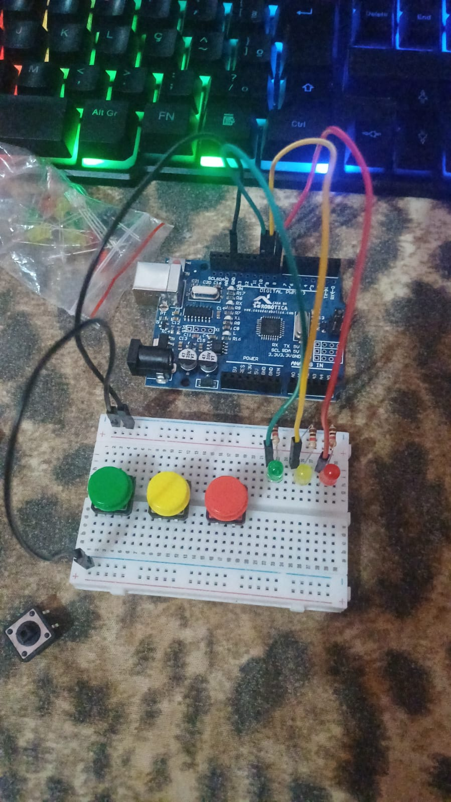
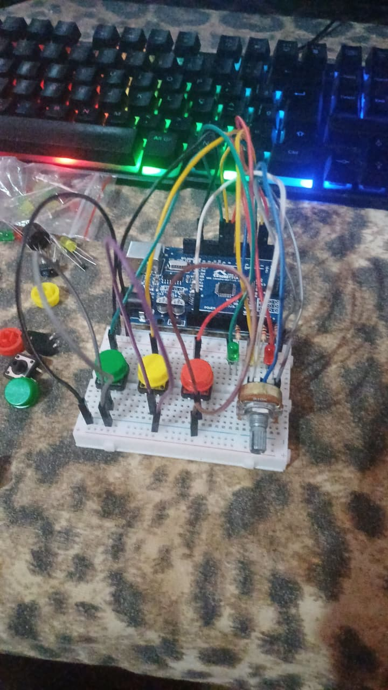
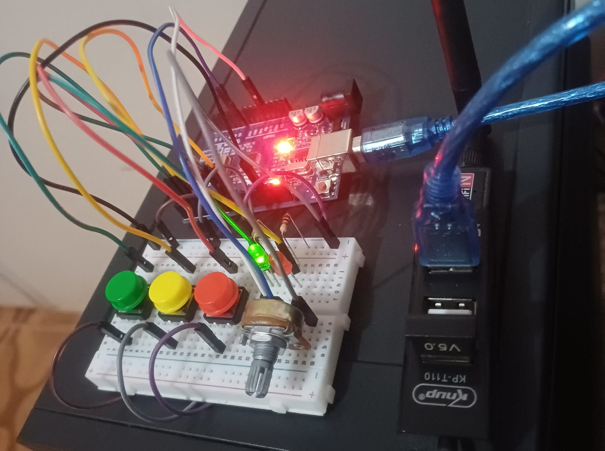

# Arduino Linux Controller


**English** | [Português (Brasil)](docs/pt-BR/README.md) | [All projects](../../README.md)

A small physical desktop controller for Ubuntu, built from an unused Arduino Uno-compatible starter kit. I wanted something useful in everyday life rather than another unfinished lab. The final device controls music, system audio and screen locking, and displays the host's network connectivity through two LEDs.


*Final build: three buttons, two LEDs and a B10K rotary potentiometer. The photograph is part of the local build record; see the [photo index](images/README.md).*

## Contents

- [Overview and controls](#overview)
- [Origin and evolution](#story)
- [Technologies and files](#stack)
- [Parts, pinout and assembly](#hardware)
- [Installation, usage and autostart](#install)
- [Difficulties and troubleshooting](#debug)
- [Validation and limitations](#validation)
- [Photo record](#photos)
- [Authorship and license](#license)

<a id="overview"></a>

## Overview and controls

### Project status

**Completed — functional personal prototype, 26 November 2026.** All main functions were reported working on the physical Ubuntu desktop. No active development, roadmap or maintenance commitment. This is not a security product, commercial peripheral or certified electrical design.

### Controls

| Control | Action |
| --- | --- |
| Green button: short / double / hold 1 s | Play/pause / previous track / next track |
| Yellow button: short | Toggle mute |
| Red button: hold 1 s | Lock the desktop |
| B10K potentiometer | Set system volume, 0–100% |
| Green LED | NetworkManager reports full internet connectivity |
| Red LED steady | No or limited internet, captive portal or disconnected network |
| Red LED blinking | Unknown status or host communication timeout |

### Architecture

```text
Buttons + potentiometer -> Arduino Uno (C++)
                              | USB serial 9600 baud
                              v
                          Python on Ubuntu
                 playerctl / wpctl / GNOME / nmcli
                              |
                       G / Y / R / U
                              v
                        Green / red LEDs
```

The Arduino does not connect to the network itself. The host checks connectivity and sends a one-character state. The Uno reads switches with internal pull-ups and reports button/volume events. The Python process runs in the logged-in user's session.

<a id="story"></a>

## Origin and evolution

### From an unused kit to a desktop controller

The original idea was an embedded security lab: an enclosure alarm using an LDR, reed switch, buzzer and event logging. That scope was abandoned. The board was instead reused for a local Ubuntu peripheral. No alarm, intrusion detection, IoT network or security monitoring was implemented in the final device.

The first desktop-controller proposal had six dedicated buttons, three network LEDs, and optional buzzer/display. Six large switches physically fit across a 400-hole breadboard, but their colored caps interfered. The design was reduced to three buttons with short, double and long presses, plus a B10K potentiometer for volume. The third LED was later removed. No additional components were purchased for this build.





<a id="stack"></a>

## Technologies and files

The controller was built for an Ubuntu desktop with GNOME, using an SMD Uno-compatible board detected as `/dev/ttyUSB0`. It requires no Docker, external servers or independent Arduino networking.

| Technology | Purpose |
| --- | --- |
| Arduino Uno / C++ | Read buttons and potentiometer; drive LEDs |
| Arduino IDE | Compile and upload firmware |
| USB serial / PySerial | Bidirectional communication at 9600 baud |
| Python 3 | Interpret events, execute commands and reconnect |
| Playerctl / MPRIS | Media control; Spotify and Firefox priority |
| PipeWire / WirePlumber (`wpctl`) | Default audio sink volume and mute |
| NetworkManager (`nmcli`) | Ubuntu connectivity status |
| GNOME / D-Bus / loginctl | Lock the graphical session |
| XDG Autostart | Launch automatically after login |
| Git / GitHub | Record the completed project |

`pactl` was installed only for troubleshooting and is not a runtime dependency of the final code.

```text
linux-controller/
├── firmware/painel_ubuntu/painel_ubuntu.ino
├── software/painel-ubuntu.py
├── diagnostics/components/components.ino
├── installation/enable-autostart.sh
├── docs/
│   ├── hardware.md
│   ├── installation.md
│   ├── development.md
│   └── pt-BR/
│       ├── README.md
│       ├── componentes-e-montagem.md
│       ├── instalacao.md
│       ├── desenvolvimento.md
│       └── registro-fotografico.md
├── images/
│   ├── arduino-01.jpeg ... arduino-14.jpeg
│   └── README.md
├── tests/
└── README.md
```

**Complete source:** [C++ firmware](firmware/painel_ubuntu/painel_ubuntu.ino), [Python host program](software/painel-ubuntu.py), [diagnostic sketch](diagnostics/components/components.ino) and [autostart helper](installation/enable-autostart.sh).

<a id="hardware"></a>

## Parts, pinout and assembly

> **Caution:** the USB-B connector showed abnormal heating and interruptions during early testing. The cause was not established. Unplug immediately if it recurs; do not leave a suspect board powered unattended. Use an insulating support.

### Parts

| Quantity | Component | Specification |
| --- | --- | --- |
| 1 | Arduino board | Uno-compatible SMD board, 5 V |
| 1 | Breadboard | 400 holes (30 numbered groups) |
| 3 | Momentary push buttons | Normally open, green/yellow/red caps |
| 1 | Green LED | Network connectivity indicator |
| 1 | Red LED | Network connectivity indicator |
| 2 | Resistors | 1 kΩ each, one per LED |
| 1 | Rotary potentiometer | B10K, 10 kΩ linear |
| As needed | Jumper wires | Male-to-male |
| 1 | USB cable | USB A–B, data and power |
| Optional | USB hub | Used in the original setup |

No battery, soldering, wireless module, sensors or yellow LED are required for the final circuit.

### Final pinout

| Part | Arduino connection | Other terminal |
| --- | --- | --- |
| Green button | D2 | GND |
| Yellow button | D3 | GND |
| Red button | D4 | GND |
| Green LED anode | D8 | Cathode → 1 kΩ → GND |
| Red LED anode | D9 | Cathode → 1 kΩ → GND |
| Potentiometer wiper (middle) | A0 | Outer terminals → 5V and GND |
| Common ground | Any GND | Both negative rails |

D10 is unused. The yellow button is still present; the yellow LED was removed. The potentiometer needs no external resistor. If clockwise rotation reduces volume, swap only its two outer wires with USB unplugged or invert the mapping in firmware.

### Assembly

1. Disconnect USB. Place the board on a rigid insulating surface; never directly on a metal case. The original board had an unresolved intermittent heating problem.
2. Turn the breadboard horizontally. Each numbered group of five holes is connected internally; the central gap isolates its two halves. Connect Arduino GND to a negative rail and bridge the two negative rails; confirm continuity if available. Do not connect the positive and negative rails.
3. Place the three buttons across the central gap, with enough space for their caps. Use two electrically distinct contacts per button (often opposite diagonal pins on a four-pin switch; verify with continuity or the switch pinout). One goes to its digital pin, the other to the common ground. No external pull-up resistor is needed.
4. Insert each LED with its legs in different numbered groups, on the same breadboard half. The longer leg is normally the anode; the flat edge identifies the cathode. Connect the anode to D8 or D9, the cathode to one end of its own 1 kΩ resistor, and the resistor's other end to GND. A resistor may be on either side of a series LED circuit.
5. Insert all three potentiometer legs into electrically separate groups. Connect the middle leg to A0 and the outer legs to 5V and GND. Do not force the spacing or allow the legs to touch.
6. Keep wires away from button caps and avoid crushing the wires routed under the breadboard. Check for shorts and exposed metal before connecting power.

```text
D2 ── switch ── GND
D3 ── switch ── GND
D4 ── switch ── GND

D8 ── LED green (+ to -) ── 1kΩ ── GND
D9 ── LED red   (+ to -) ── 1kΩ ── GND

5V ── [ potentiometer 10kΩ ] ── GND
                 |
              wiper A0
```

A 1 kΩ resistor was selected for modest indicator brightness; 200 Ω resistors were also available but not selected for the final instructions. Use the final pinout and electrical connections above as the wiring reference.

<a id="install"></a>

## Installation, usage and autostart

Get the files using GitHub's **Code → Download ZIP** or clone the repository:

```bash
git clone https://github.com/kayo-willian/arduino-projects.git
cd arduino-projects/projects/linux-controller
```

### 1. Prepare Ubuntu

The working environment used Ubuntu with GNOME, PipeWire/WirePlumber and NetworkManager. Install the additional dependencies:

```bash
sudo apt update
sudo apt install -y python3-serial playerctl wireplumber network-manager libglib2.0-bin
sudo usermod -aG dialout "$USER"
```

Log out and back in to apply the group membership. Do not run the host program with sudo: media, audio and screen locking need your desktop session. Check the tools using `command -v python3 playerctl wpctl nmcli gdbus loginctl`. The optional diagnostic tool `pactl` is provided by `pulseaudio-utils`; it is not needed at runtime.

### 2. Upload the firmware

Open [painel_ubuntu.ino](firmware/painel_ubuntu/painel_ubuntu.ino) in Arduino IDE. Select Arduino Uno, the correct serial port (originally /dev/ttyUSB0) and upload. Close the Python process before uploading, then close the serial monitor and the IDE before running Python. Only one program should own the serial port.

The green and red LEDs light sequentially at startup. The red LED then blinks until the host provides its connectivity state.

### 3. Run the host program

From the project root:

```bash
cp software/painel-ubuntu.py ~/painel-ubuntu.py
python3 -u ~/painel-ubuntu.py
```

Expected example output (actual port may differ):

```text
Arduino conectado: /dev/ttyUSB0
READY
PLAY_PAUSE
NEXT
PREVIOUS
MUTE
VOLUME:50
LOCK
```

The output is reproduced exactly as emitted by the supplied program. Its status messages are in Portuguese; the serial event identifiers are language-independent and must not be translated in the code.

| Original message/event | Meaning |
| --- | --- |
| `Aguardando Arduino...` | Waiting for Arduino |
| `Arduino conectado:` | Arduino connected |
| `Arduino desconectado:` | Arduino disconnected or serial error |
| `READY` | Firmware ready |
| `PLAY_PAUSE` | Play/pause |
| `NEXT` | Next track |
| `PREVIOUS` | Previous track |
| `MUTE` | Toggle mute |
| `VOLUME:50` | Set volume to 50% (example) |
| `LOCK` | Lock session |

READY may be missed during connection/reset; the host does not require it. The script automatically selects a port only if exactly one /dev/ttyUSB* or /dev/ttyACM* device is present. Disconnect unrelated serial devices or edit find_arduino for your setup. It retries connection after serial errors.

The firmware remains stored in flash when USB power is removed. With the host program running, it searches for an eligible serial port every three seconds while disconnected and attempts to reopen it after a serial error. Reconnecting the USB cable normally requires neither a new upload nor opening Arduino IDE. This assumes the desktop session is active, the host process is running, and exactly one eligible serial device is present.

### 4. Functional checks

| Test | Expected |
| --- | --- |
| Open Spotify, tap green | Play/pause |
| Double tap green | Previous track |
| Hold green for 1 second | Next track |
| Tap yellow | Toggle mute |
| Turn potentiometer | Change system volume (0–100%) |
| Hold red for 1 second | Lock the session |
| Disconnect network (all active interfaces) | Red LED after connectivity refresh |
| Restore internet | Green LED |
| Stop Python with Ctrl+C | Red blinks after 7 seconds |

NetworkManager checks run approximately every 15 seconds, plus command runtime; the host sends its cached state every 2 seconds. Its result is not a guarantee that every website is reachable. The potentiometer only sends a new value after movement of at least two percentage points (or an endpoint); it does not force a volume change on startup.

### 5. Autostart on desktop login

Once manual tests pass, stop the foreground process with Ctrl+C. Run [enable-autostart.sh](installation/enable-autostart.sh) from the project root:

```bash
bash installation/enable-autostart.sh
```

This copies the supplied Python script to ~/painel-ubuntu.py and creates a per-user desktop autostart entry. It will launch at graphical login, not at system boot before login. Log out and in to test. Do not start another copy while the autostart instance is running. If ~/painel-ubuntu.py already exists with different content, the installer stops to avoid overwriting it.

### 6. Troubleshooting commands

Use these individually, only for the purpose described.

| Purpose | Command |
| --- | --- |
| Check running panel | `pgrep -af painel-ubuntu.py` |
| Stop panel before firmware upload | `pkill -f 'python3.*painel-ubuntu\.py'` |
| Inspect serial port owner | `sudo fuser -v /dev/ttyUSB0` |
| List media players | `playerctl --list-all` |
| Test Spotify | `playerctl --player=spotify play-pause` |
| Read audio volume | `wpctl get-volume @DEFAULT_AUDIO_SINK@` |
| Check connectivity | `nmcli networking connectivity check` |
| Disable future autostart | `rm ~/.config/autostart/painel-ubuntu.desktop` |

To start manually in the background after confirming no other instance is running:

```bash
nohup python3 -u ~/painel-ubuntu.py > ~/.painel-ubuntu.log 2>&1 &
```

To remove autostart, use the command in the table; it does not stop the current process. If the USB connector gets abnormally hot, disconnect it immediately and investigate before further use.

See the [development log](#debug) for the actual troubleshooting history.

<a id="debug"></a>

## Difficulties and troubleshooting

### Physical assembly

| Problem or question | Observation, hypothesis and resolution |
| --- | --- |
| USB-B connector warming and intermittent shutdown | The board previously worked for hours. Cable damage, bad connector/solder, hub power and a short against a metal table were considered. Moving the board and isolating it was advised; operation resumed. Cause not established. |
| Small workspace | The Uno cannot plug into the breadboard like a Nano. The breadboard was placed horizontally, with the board behind it. An insulating support is required. |
| Illustrations misleading | Preliminary wiring illustrations contained inaccurate hole positions, pin labels and potentiometer connections. The final electrical pinout and physical component tests took precedence. |
| Resistor inventory | Actual values were 200 Ω, 1 kΩ and 10 kΩ, not the initially assumed 330 Ω. 1 kΩ was selected for indicators; current limiting works on either side of an LED in series. |
| Long resistor leads | Leads can be bent carefully, without pulling them out or allowing shorts. No cutting was required for the final plan. |
| Buttons difficult to press | Caps collided with six switches; three switches solved spacing. Long ground jumpers obstructed access; the final physical routing was changed, including passing wires beneath the breadboard. |
| Common ground | Both negative rails were connected; buttons use INPUT_PULLUP rather than external resistors. Any labeled Arduino GND is suitable. |
| Pin reversals | The first layout had green button D4, red D2; green LED D10, red D8. The components were swapped, yielding green D2/D8 and red D4/D10 initially. After removing the yellow indicator, the red LED ultimately occupied D9, not D10. |
| Potentiometer placement | Three distinct breadboard groups were required, with the middle contact to A0 and outer contacts to 5V/GND. No extra 10 kΩ resistor. |






### Firmware and host debugging

| Symptom | Diagnosis and outcome |
| --- | --- |
| Upload error: programmer out of sync | Compiler succeeded (3700 bytes flash, 291 bytes global RAM for that intermediate sketch), but upload failed with sync byte 0x14 vs 0x00 and unable to write flash (rc = -1). Serial contention or USB instability were suspected. Closing the IDE/monitor or competing program, checking the port and reconnecting were recommended. No definitive cause was recorded for this particular upload error. |
| Only yellow seemed responsive | Mute worked; green long press advanced tracks and red long press locked the desktop. This ruled out a general failure of all buttons. A temporary component sketch was suggested to isolate electrical input. |
| Green short press did not pause Spotify | playerctl --list-all showed firefox.instance_1_99 and spotify. The explicit command playerctl --player=spotify play-pause worked. The host was changed to prioritize spotify,firefox for all three media operations; the short press then worked. |
| Potentiometer failed to control volume | A0 jumper was found disconnected and reattached. Direct wpctl commands returned without errors; pactl was initially missing, so pulseaudio-utils was installed for diagnostics. No output on successful volume commands is normal. Reading analogRead(A0) directly was suggested; the final complete panel was subsequently reported working, but no raw ADC log or definitive secondary cause was supplied. |
| Three indicators unnecessary | Yellow LED removed; the firmware combined limited/no internet and disconnected states into one red indicator. The yellow physical button remained. |
| Offline LED would not light | Sending R through the serial monitor did not light it. The code still targeted D10, but the indicator was physically connected to D9. Correcting the pin and replacing the temporary yellow LED with red resolved the mismatch. |
| Device or resource busy | Python repeatedly failed with Errno 16 on /dev/ttyUSB0 and later printed READY; no buttons responded at that point. A common-ground issue was considered, but contention between Arduino IDE and the host was subsequently observed. Closing the IDE and avoiding duplicate Python processes resolved the reported conflict. |
| Autostart removed accidentally | The optional removal command was executed along with the others. The desktop entry was recreated and the process checked. |
| Duplicate host processes after manual restart | Two Python processes (PIDs 25218 and 25280) were observed. Both reported 0.3% CPU and approximately 13.4–13.5 MiB resident memory. Both were stopped and one process was started; pgrep then showed only PID 31492. These are historical measurements, not current process IDs or a guaranteed resource budget. |

Relevant error excerpts:

```text
Error: protocol expects sync byte 0x14 but got 0x00
Error: programmer is out of sync
Error: unable to write flash (rc = -1)
Failed uploading: uploading error: exit status 1
Arduino desconectado: [Errno 16] could not open port /dev/ttyUSB0:
[Errno 16] Device or resource busy: '/dev/ttyUSB0'
Arduino conectado: /dev/ttyUSB0
READY
```

The original error output is kept unchanged for troubleshooting. The messages below explain its meaning.

| Original message | Meaning |
| --- | --- |
| `protocol expects sync byte 0x14 but got 0x00` | Expected synchronization byte differs from the received byte |
| `programmer is out of sync` | Communication with the programmer is not synchronized |
| `unable to write flash (rc = -1)` | Writing to flash failed |
| `Failed uploading: uploading error: exit status 1` | Firmware upload failed |
| `Device or resource busy` | Device or resource is occupied |
| `Arduino desconectado` / `Arduino conectado` | Arduino disconnected / connected |
| `READY` | Firmware ready |

Useful isolated tests: stop Python first, send G/R/U using the serial monitor at 9600 baud (LED timeout 7 s); test the switch readings and A0 with the [component diagnostic sketch](diagnostics/components/components.ino); re-upload the main firmware afterwards. The included diagnostic combines earlier suggested tests for the final pinout, rather than reproducing a separately validated sketch.

<a id="validation"></a>

## Validation and limitations

### Final acceptance

The builder reported all functions working after resolving the pin and serial conflicts: play/pause, previous/next, mute, volume, screen lock, online/offline LEDs. Autostart was configured and the process was observed running. Repeated reboot testing, long-term electrical stability, exact timings and behavior on other distributions were not independently validated.

### Technical notes and limitations

- Serial: 9600 baud, ASCII lines from firmware (READY, PLAY_PAUSE, PREVIOUS, NEXT, MUTE, LOCK, VOLUME:n); G/Y/R/U characters from host. Y and R both mean red steady; U means blinking. No authentication or USB HID emulation.
- Firmware: active-low inputs, 35 ms debounce, 350 ms double-click interval, 1 s long press; eight ADC samples averaged every 100 ms, 2% volume threshold; host timeout 7 s.
- Host: one serial device assumed, commands via subprocess without a shell, desktop-session access required; media limited to supported MPRIS players with Spotify/Firefox priority. No network data is received directly by the Arduino.
- Connectivity is NetworkManager's assessment, not an independent internet availability guarantee. Command execution can delay serial processing; reconnection is best effort.
- No formal automated tests or endurance tests were performed on the physical prototype. The source is reconstructed from the conversation, preserving the working logic and final pinout. The autostart helper and combined diagnostic are documentation additions, not claimed hardware-tested.
- The original heating incident remains unresolved; isolate the PCB and unplug on abnormal heat or instability.

The project ends here: a functional personal peripheral, not a maintained platform.

### Optional automated checks

The [test suite](tests/) uses Python's standard library to exercise host commands and network states with mocks, check the firmware's static contract, test autostart installation in an isolated temporary home and verify local documentation links and bilingual structure.

From the project root, on Linux with Python 3 and Bash:

```bash
python3 -m unittest discover -s tests -v
```

These checks do not need an Arduino, PySerial, internet access or desktop commands. They do not replace firmware compilation, physical tests or electrical validation. The original 38 tests passed offline with Python 3.12 and 3.13. Repeated test cases were subsequently grouped into subtests. The suite was added after the original build.

<a id="photos"></a>

## Photo record

All 14 distinct photographs are preserved in [images/](images/). The early photos show assembly in progress; the final-session set contains several angles and a board-only photograph. Earlier images are not final wiring instructions.

| Set | Photographs |
| --- | --- |
| First tests and assembly | [01](images/arduino-01.jpeg) · [02](images/arduino-02.jpeg) · [03](images/arduino-03.jpeg) · [04](images/arduino-04.jpeg) · [05](images/arduino-05.jpeg) · [06](images/arduino-06.jpeg) |
| Final session | [07](images/arduino-07.jpeg) · [08](images/arduino-08.jpeg) · [09](images/arduino-09.jpeg) · [10](images/arduino-10.jpeg) · [11](images/arduino-11.jpeg) · [12](images/arduino-12.jpeg) · [13](images/arduino-13.jpeg) · [14](images/arduino-14.jpeg) |

| Front view | Another view of the device |
| --- | --- |
|  |  |

See the [photo index](images/README.md) as well.

<a id="license"></a>

## Authorship and license

### Authorship

I assembled the circuit, changed the wiring, uploaded the firmware and tested the physical device. The published source reconstructs the working version from the development records; it is not a byte-for-byte copy of the local files.

Separate reference pages remain available: [hardware](docs/hardware.md), [installation](docs/installation.md) and [development log](docs/development.md). All information needed to reproduce the project is included in this README.

Licensed under the [MIT License](../../LICENSE).

### Credits

ChatGPT (AI) assisted with the C++ and Python code, troubleshooting, and technical documentation.
